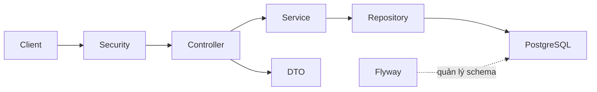
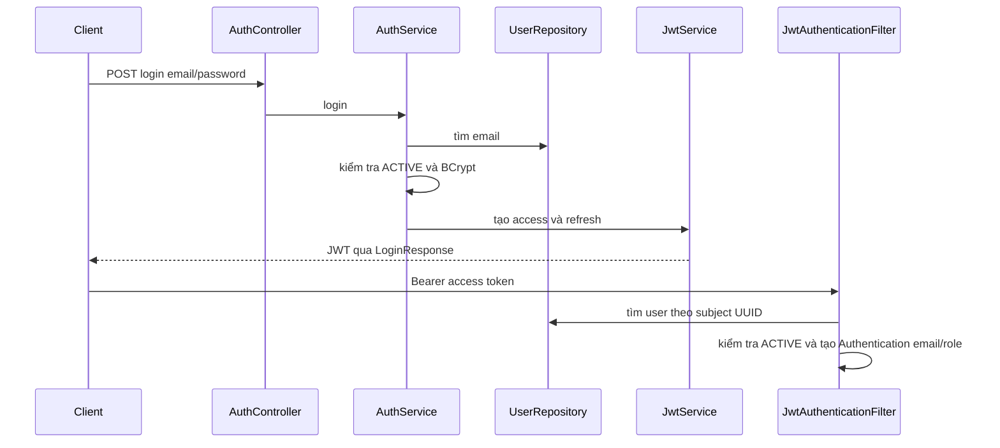
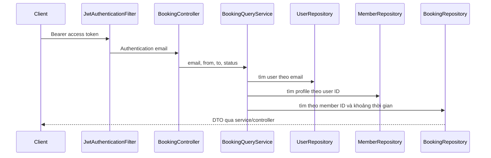

# Kiến trúc thực tế

Mã Java ở [backend/src/main/java/vn/edu/tdtu/fitcenter](../../backend/src/main/java/vn/edu/tdtu/fitcenter/); `controller`, `service`, `repository`, `domain/entity`, `domain/enums`, `dto`, `security`, `config`, `exception`, `web` phân tách theo vai trò. Kiểm thử ở [backend/src/test](../../backend/src/test/); migrations chuẩn ở [database/migrations](../../database/migrations/).

DTO là contract HTTP, entity ánh xạ JPA; không giả định entity được trả trực tiếp. Login dùng BCrypt, JWT access/refresh; filter kiểm tra token và tài khoản rồi thiết lập Authentication. [SecurityConfig](../../backend/src/main/java/vn/edu/tdtu/fitcenter/config/SecurityConfig.java) áp role theo URL; service kiểm tra lại role/trạng thái và profile cho các truy vấn sở hữu. [ApiExceptionHandler](../../backend/src/main/java/vn/edu/tdtu/fitcenter/exception/ApiExceptionHandler.java) chuẩn hóa lỗi; filter cấp correlation ID.

`users.id` là ID tài khoản; `members.id` và `personal_trainers.id` là ID profile riêng, có `user_id` tham chiếu user. JWT xác định user; authentication dùng email, service tìm User rồi tìm Member/PT qua user ID, sau đó truy vấn theo profile ID. Không dùng user ID thay profile ID trong booking. Các service đọc dùng `@Transactional(readOnly=true)`; các transaction ghi và chống cạnh tranh cho booking/payment chưa được triển khai.

Maven loại migrations cũ trong `backend/src/main/resources/db/migration`, đóng gói `database/migrations` thành `classpath:db/migration`. Flyway validate khi migrate và Hibernate `ddl-auto=validate`. Kiểm tra artifact thực tế trước chạy; xem [database](04_DATABASE_GUIDE.md).

## Luồng xác thực và truy vấn

Luồng PT tương tự qua `PersonalTrainerRepository`. Security filter trả 401/403 qua entry point/handler; lỗi controller/service qua `ApiExceptionHandler`, correlation filter gắn ID. Query services và membership/plan reads dùng transaction read-only; auth không khai báo transaction. Flyway quản lý schema PostgreSQL khi ứng dụng khởi động.
