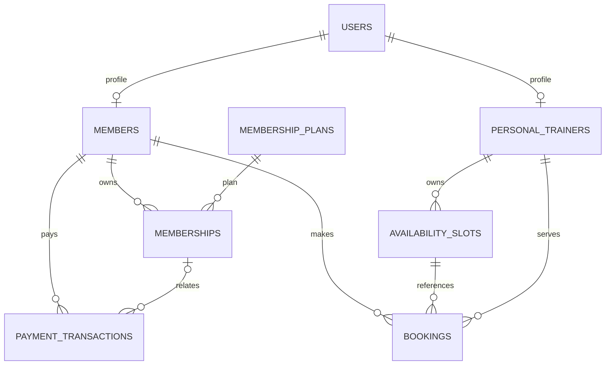

# Database và migrations

[V1–V6](../../database/migrations/) là nguồn canonical được POM đóng gói; [migrations cũ](../../backend/src/main/resources/db/migration/) bị loại khỏi Maven resources, không chạy song song. V1: users/members/PT; V2: plans/memberships/payment; V3: face/attendance; V4: slot/booking/policy; V5: workout/notifications; V6: audit. Profile mặc định dùng `DB_URL`; profile alignment có URL mặc định khác và có thể trỏ nhầm DB bảo vệ.

UUID là khóa; `members.user_id` và `personal_trainers.user_id` có composite FK với role trong users. Membership tham chiếu member và plan; payment tham chiếu member, plan và membership tùy chọn; slot tham chiếu PT; booking tham chiếu member, PT và slot. `TIMESTAMPTZ` biểu diễn thời điểm, JDBC UTC; ngày nghiệp vụ membership tính theo `Asia/Ho_Chi_Minh`. Enum Java lưu chuỗi tương ứng CHECK SQL, không tự thêm giá trị mà không có migration phù hợp.

V4 composite FK `(slot_id, pt_id, start_at, end_at)` đảm bảo booking khớp slot. EXCLUDE GiST ngăn slot PT chồng giờ khi không DISABLED, và booking CONFIRMED chồng giờ cho PT hoặc member. Unique partial index giới hạn một booking CONFIRMED/slot. Hủy yêu cầu metadata; PT hủy cần lý do; hoàn thành cần timestamp. Những constraint này không tự đồng bộ trạng thái slot với booking: luồng ghi tương lai cần transaction, khóa/cạnh tranh, idempotency và kiểm thử đồng thời.

Không sửa migration đã áp dụng, không tự `repair`/`clean`, không xóa lịch sử thanh toán. V7 không có trong canonical HEAD; `fix/database-canonical-layout` có V7 dưới `database/database/migrations/`, xóa `payment_transactions.period_start/period_end` trước khi tạo periods. Chưa thấy bằng chứng chuyển dữ liệu lịch sử trong phần này; cần audit toàn bộ migration, dữ liệu, rollback và phê duyệt nhóm trước khi áp dụng. Không suy ra đề xuất đã được chấp thuận. DB phát triển, DB test và DB bảo vệ phải tách biệt; không kết nối DB bảo vệ để lập tài liệu.

## Danh mục bảng và quan hệ

Mỗi bảng dưới đây có khóa chính UUID `id` theo migration. Các FK và trường đặc trưng được liệt kê để định hướng; định nghĩa đầy đủ, CHECK và index nằm trong SQL canonical.

| Migration | Bảng | FK / dữ liệu chính / vai trò |
|---|---|---|
| V1 | users | email unique không phân biệt hoa thường; role MEMBER/PT/ADMIN và status; auth |
| V1 | members, personal_trainers | `user_id,user_role` tham chiếu users; profile riêng, dùng xác định ownership |
| V2 | membership_plans | name, duration_days, price, status; API plan |
| V2 | memberships | member_id tham chiếu members, plan_id tham chiếu plans; start/expiry/status; API membership |
| V2 | payment_transactions | member_id, plan_id, membership_id tùy chọn; provider_ref unique, amount, status, period; chưa có API Java |
| V3 | facial_profiles, attendance_records | member_id tham chiếu members; template_ref/status và checked_in_at/dedupe_key; chưa có API Java |
| V4 | availability_slots | pt_id tham chiếu personal_trainers; start/end/status/version; API slots |
| V4 | bookings | member_id, pt_id và FK ghép tới slot; start/end/status/cancel/completed; API lịch |
| V4 | booking_policy | updated_by tham chiếu users tùy chọn; giới hạn, effective_from, active; chưa có API Java |
| V5 | workout_plans, workout_plan_items, workout_completions | PT/member; item tham chiếu plan; completion tham chiếu item/member; chưa có API Java |
| V5 | notifications | user_id tham chiếu users, type/title/body/read_at; chưa có API Java |
| V6 | audit_logs | actor_user_id tham chiếu users tùy chọn, action/entity/details; chưa có API Java |

V7 trong nhánh riêng tạo periods, trigger và view, nhưng xóa period_start/end của payment trước đó mà không có chuyển dữ liệu trong nội dung đã xem. Đây là rủi ro mất lịch sử, không coi đã phê duyệt. Index V2 `uq_membership_one_current_per_member` áp dụng cho mọi status khác CANCELLED; `uq_payment_provider_ref` đảm bảo provider_ref duy nhất. Index V4 chỉ cho một policy active, nhưng không tự định nghĩa ý nghĩa của `effective_from`.
